<div align="center">

# 🛰️ Mission Baseline

### How did an astronaut's recorded health indicators change compared with their own preflight readings?

**A health-data exploration prototype built on NASA's public Inspiration4 lab data (OSD-575). It shows what changed, how large the change was, whether the reading sits inside the lab's reference range, and every reason for caution. It never diagnoses.**

<sub>Formerly AstroVitals. The wearable and Earth-data features below still work and are kept as future additions.</sub>

Built for the NASA Space Apps Challenge 2026:
[*Create Health Monitoring Software for Astronauts on Space Missions*](https://www.spaceappschallenge.org/2026/challenges/create-health-monitoring-software-for-astronauts-on-space-missions/)


</div>

> [!WARNING]
> **Not a medical device.** This is a software and data-visualization prototype. It does not
> diagnose, treat or prevent anything. Out-of-range readings are flagged as *data-quality* issues
> (sensor fit, motion, sync), never as health findings, and the overlay view is labelled
> *exploratory only*.

---

## 📑 Table of contents

1. [What it does](#-what-it-does)
2. [Feature status](#-feature-status)
3. [System architecture](#️-system-architecture)
4. [How a request travels through the server](#-how-a-request-travels-through-the-server)
5. [Data flows, step by step](#-data-flows-step-by-step)
6. [The wearable provider model](#-the-wearable-provider-model)
7. [The NASA data layer](#-the-nasa-data-layer)
8. [Data model and normalization](#-data-model-and-normalization)
9. [Database schema](#️-database-schema)
10. [Security and privacy](#-security-and-privacy)
11. [The web dashboard](#️-the-web-dashboard)
12. [Getting started](#-getting-started)
13. [Configuration](#️-configuration)
14. [REST API at a glance](#-rest-api-at-a-glance)
15. [Testing](#-testing)
16. [Project structure](#-project-structure)
17. [Known limits and roadmap](#️-known-limits-and-roadmap)
18. [Documentation](#-documentation)
19. [License and attribution](#-license-and-attribution)

---

## 🌍 What it does

Astronauts on long missions wear sensors while the space environment around them changes: solar
flares, coronal mass ejections, geomagnetic storms. AstroVitals is a prototype of the ground-side
software for that problem, built with tools anyone can try today. It puts two kinds of data side by side:

| 🛰️ From NASA | ⌚ From a wearable |
|---|---|
| Solar flares, CMEs, geomagnetic storms (Kp), solar energetic particles — **DONKI** | Heart rate, resting HR, HRV (RMSSD / SDNN) |
| Wildfires, storms, volcanoes on a map — **EONET** | Blood oxygen (SpO₂), respiratory rate |
| Surface temperature, humidity, pressure, wind, irradiance, UV — **POWER** | Skin temperature & deviation |
| Astronomy Picture of the Day — **APOD** | Steps, active energy, sleep stages, workouts |

Then it lets you **overlay** one against the other, with honest statistics and caveats attached.

Three rules shape the whole design:

1. **Never mix data sources.** Every record says where it came from. Simulated data is drawn dashed,
   badged `SIMULATED`, and **cannot be saved to the database**: the store throws if you try.
2. **Never alter raw measurements.** Unit conversions keep the original value alongside the converted one.
3. **Never make medical claims.** Quality flags talk about sensors; correlations say *exploratory*.

---

## ✅ Feature status

| Feature | Status |
|---|---|
| NASA DONKI space weather (flares, CMEs, geomagnetic storms/Kp, SEP) | ✅ live, keyless, cached |
| NASA EONET natural events on a lat/lon map | ✅ live, keyless |
| NASA APOD (new endpoint + legacy fallback) | ✅ live |
| NASA POWER surface environment | ✅ live, keyless |
| **Mission Baseline** — Inspiration4 crew lab values (NASA OSD-575) vs each person's own preflight median | ✅ bundled dataset, CC0 |
| Demo mode (realistic simulated vitals, never stored, always labelled) | ✅ |
| **Apple Watch via Health app export** (upload `export.xml`) | ✅ works with any Apple Watch, no Mac needed |
| Apple Watch via HealthKit companion iOS app | ✅ backend ingest + device tokens; iOS app is Swift reference code ([`companion/ios/`](companion/ios/)) |
| Fitbit / Pixel Watch via **Google Health API** (OAuth 2.0 + PKCE) | ✅ implemented and tested against mocks; ⚠️ needs Google access ([why](#two-discoveries-that-shaped-the-build)) |
| Garmin Health API | ⛔ approval-only; adapter slot + docs |
| Exploratory overlay (wearable vs NASA, scatter + Pearson r with caveats) | ✅ |
| Privacy: export, delete data, disconnect + revoke, delete account, retention job | ✅ |

### Two discoveries that shaped the build

*Verified 2026-10-05.*

1. **The Fitbit Web API shuts down on 2026-10-30.** Its replacement, the **Google Health API**, is
   "not onboarding new projects at this time". A new team cannot get Fitbit data through a web
   OAuth flow right now. The provider is built to the official spec and switches on as soon as
   `GOOGLE_HEALTH_CLIENT_ID` / `SECRET` are set. **For an Apple Watch, use the Health export today.**
2. **Two NASA endpoints moved in September 2026.** DONKI now lives at
   `https://ccmc.gsfc.nasa.gov/DONKI-API/get/…`, and the documented `api.nasa.gov/DONKI` URLs redirect
   to an HTML page. APOD moved to `https://science.nasa.gov/wp-json/wp/v2/apod-basic`, and the
   legacy endpoint retires on 2026-12-01. The code uses the new endpoints.

---

## 🏗️ System architecture

The browser only talks to **our own server**. It holds no API keys and no OAuth tokens, just an
`httpOnly` session cookie. The server talks to NASA and to the wearable platforms.

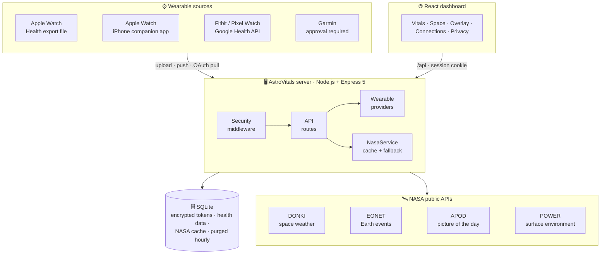

<details>
<summary><b>Plain-text version (for terminals)</b></summary>

```
Apple Watch ─► HealthKit (iPhone) ─┬─► Health app export.xml ──upload──────┐
                                   └─► companion iOS app ──POST + token────┤
Fitbit/Pixel ─► Google Health cloud ──OAuth2 + PKCE (server pull)──────────┤
Garmin ─► Garmin Connect ──(push webhook, approval required)───────────────┤
                                                                           ▼
NASA DONKI / EONET / APOD / POWER ◄── NasaService ◄── Express API ──► SQLite (encrypted tokens,
                                         (cache)          ▲             normalized metrics, retention)
                                                          │ same-origin /api, httpOnly cookie
                                                React dashboard (browser)
```

</details>

### Monorepo layout

The repo is three npm workspaces. The **shared** package is the contract both sides compile against,
so an API change that breaks the web app fails `typecheck`.

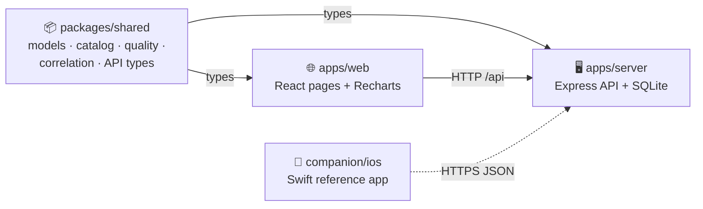

### Technology stack

| Layer | Choice | Why |
|---|---|---|
| Frontend | React 19 + TypeScript, Vite 8 | Fast dev server with an `/api` proxy, so cookies stay first-party |
| Charts | Recharts 3 | Declarative React charts: time axes, tooltips, small multiples |
| Backend | Node.js 24 + TypeScript (run with `tsx`), Express 5 | Express 5 forwards async errors natively |
| Validation | Zod 4 | One schema per input: env, query, body, ingest payload |
| Database | SQLite via Node's built-in `node:sqlite` | No native build step on any OS; plain parameterized SQL ports to Postgres |
| Security | helmet, express-rate-limit, AES-256-GCM + scrypt from `node:crypto` | No third-party crypto |
| Logging | pino with redaction, path-only request logs | Logs can't carry health values |
| Tests | Vitest 5, Supertest, Testing Library | One runner for all three packages |

---

## 🔀 How a request travels through the server

Every request passes through the same middleware stack, in this order
([`apps/server/src/app.ts`](apps/server/src/app.ts)):

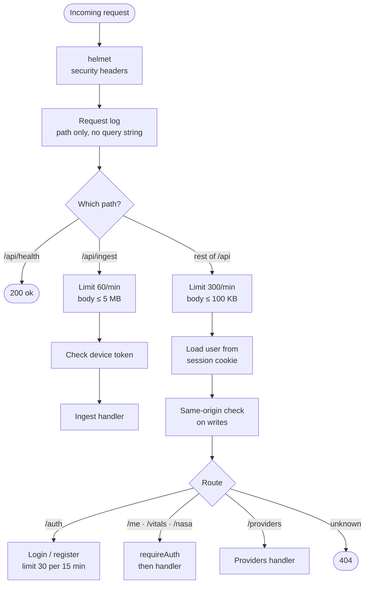

If anything throws, one error handler decides what the client sees:

| Error | Response | What gets logged |
|---|---|---|
| `HttpError` (validation, auth, not found) | its status + `{ error, message }` | nothing extra |
| `UpstreamError` (NASA or Google failed) | `502 upstream_unavailable` | upstream name + status; the upstream body is never forwarded |
| anything else | `500 internal` | error class + stack location only, never the request body |

In production the same server also serves the built React app from `apps/web/dist`, so the whole
product runs on one origin.

---

## 🔄 Data flows, step by step

### 1. Loading the dashboard

`GET /api/vitals` asks every connected provider for the time range, merges the results, and keeps
per-source counts so the UI can label each series.

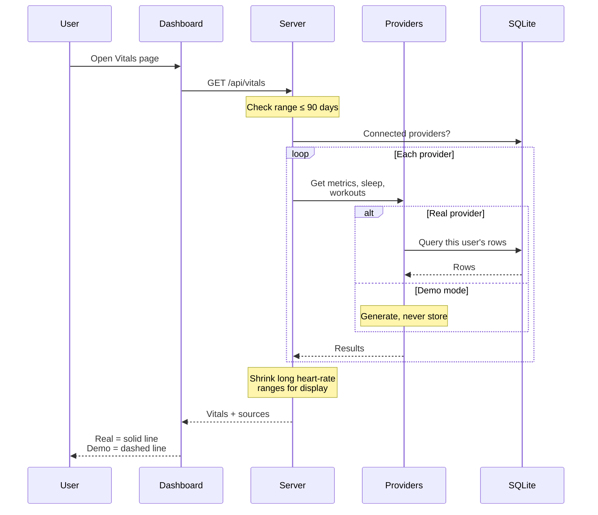

### 2. Connecting Fitbit / Pixel Watch (Google Health OAuth)

Authorization code flow with **PKCE S256**, a single-use `state`, and **session binding**: the user
who finishes the callback must be the same user who started it.

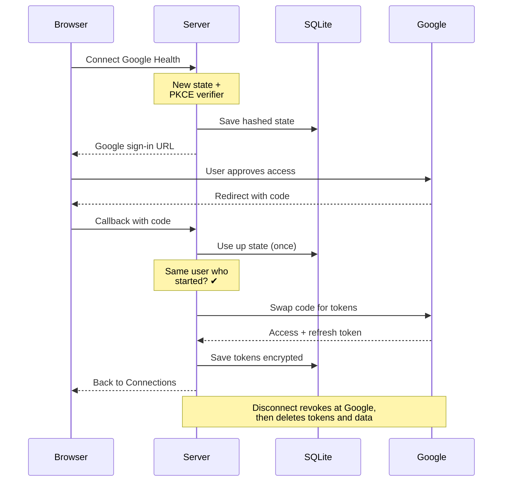

### 3. Importing an Apple Watch export

No Mac or developer account needed. Exports can run to several GB, so the file is **streamed line
by line**, never loaded into memory whole.

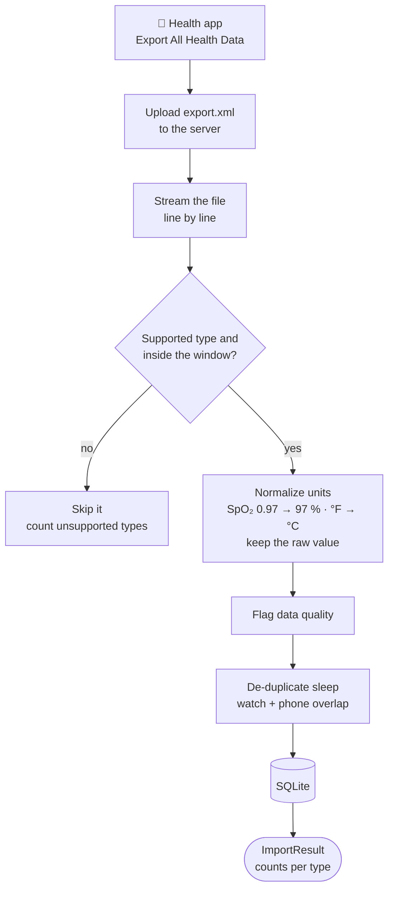

### 4. Continuous sync from the HealthKit companion app

Apple has **no web or cloud API for HealthKit**, so continuous sync needs a native iPhone app.
The reference app in [`companion/ios/`](companion/ios/) wakes when HealthKit has new data and pushes it.

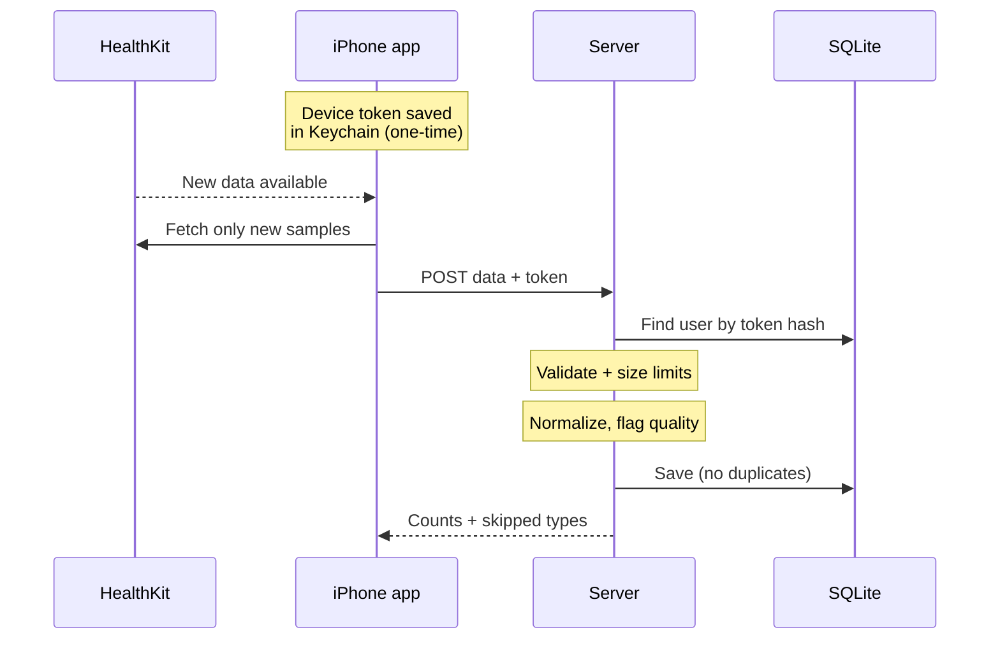

---

## 🧩 The wearable provider model

Every data source implements the same interface
([`wearables/types.ts`](apps/server/src/wearables/types.ts)), so the vitals route never needs to
know which platform it is talking to.

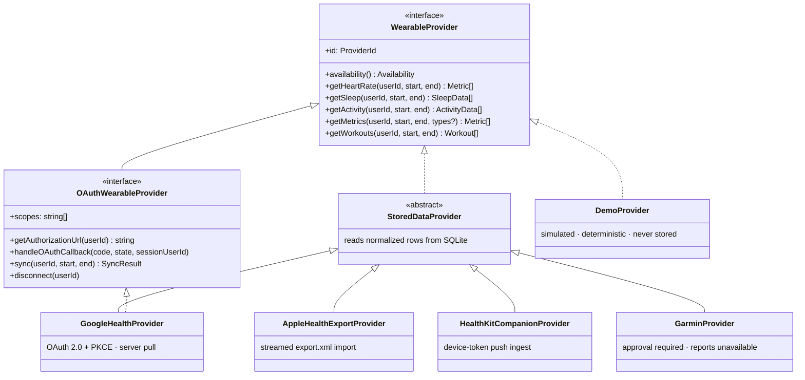

| Provider | How data gets in | Where reads come from |
|---|---|---|
| `DemoProvider` | generated per request, deterministic per user and day | memory only, **never stored** |
| `GoogleHealthProvider` | `sync()` pulls from Google Health API v4 | SQLite |
| `AppleHealthExportProvider` | streamed `export.xml` upload | SQLite |
| `HealthKitCompanionProvider` | `POST /api/ingest/healthkit` from the iPhone app | SQLite |
| `GarminProvider` | adapter slot; Garmin Health API is approved partners only | reports unavailable |

**Adding a platform** takes one class, one line in
[`wearables/registry.ts`](apps/server/src/wearables/registry.ts), and its id in `PROVIDER_IDS`. The
registry throws at startup if any id is left unregistered.

---

## 🛰️ The NASA data layer

All NASA traffic goes through [`NasaService`](apps/server/src/nasa/service.ts). Responses are cached
in SQLite so many users share one upstream budget. If NASA is down, the last good copy is served
**and labelled stale**.

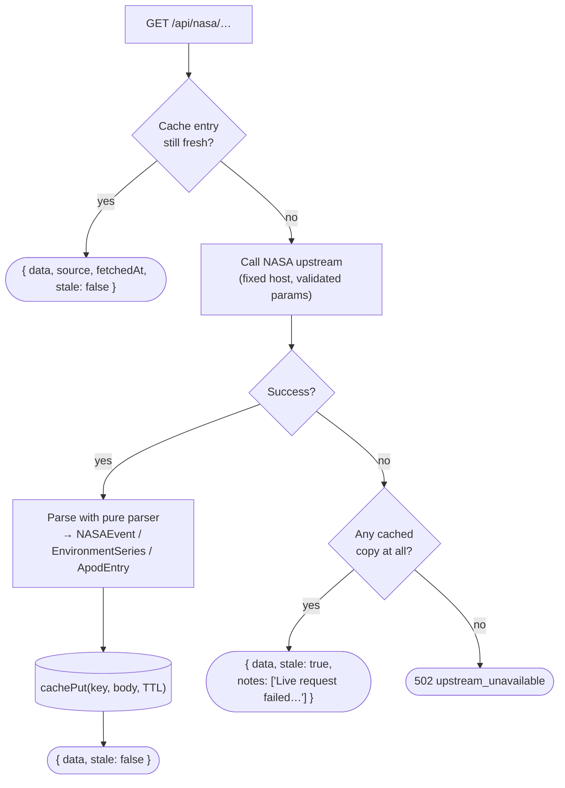

| Endpoint | Upstream | Cache TTL | Notes |
|---|---|---|---|
| `/api/nasa/space-weather` | DONKI `FLR`, `GST`, `CME`, `SEP`, fetched **in parallel** | 30 min | merged and sorted newest first |
| `/api/nasa/earth-events` | EONET v3 `/events` | 15 min | filter by days, status, category |
| `/api/nasa/apod` | `science.nasa.gov` WordPress API → falls back to `api.nasa.gov` | 6 h | image credit always shown |
| `/api/nasa/environment` | POWER daily point | 6 h | lat/lon **rounded to the 0.5° grid** before leaving the server (privacy + shared cache) |
| `/api/nasa/radiation` | NOAA SWPC GOES integral protons (24 h) + NOAA scales, fetched **in parallel** | 5 min | S-scale taken from NOAA, never recomputed; "unknown" if missing |

The parsers (`donki.ts`, `eonet.ts`, `apod.ts`, `power.ts`) are pure functions, tested against
**real captured NASA responses** in [`apps/server/test/fixtures/`](apps/server/test/fixtures/).

---

## 📐 Data model and normalization

Every reading from every platform becomes the same `Metric` shape
([`packages/shared/src/models.ts`](packages/shared/src/models.ts)):

```ts
interface Metric {
  timestamp: string            // original, with its UTC offset
  metricType: MetricType       // heart_rate | hrv_rmssd | spo2 | steps | …
  value: number                // canonical unit
  unit: string                 // bpm, ms, %, br/min, °C, steps, kcal
  raw?: { value; unit }        // the untouched original, when converted
  source: ProviderId           // which provider
  sourceDetail?: string        // upstream app, e.g. "Apple Watch"
  device?: string
  aggregation: 'sample' | 'interval' | 'daily'
  simulated: boolean           // true only for demo data
  quality?: { status: 'ok' | 'out_of_range' | 'implausible'; note?: string }
}
```

### From raw reading to stored row

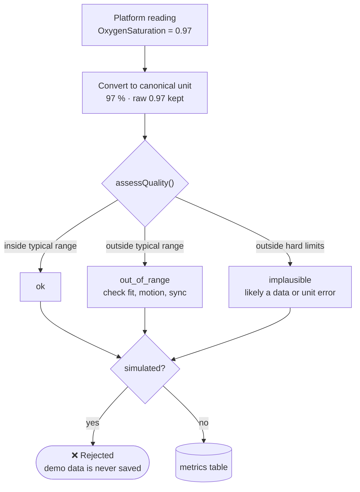

**Quality flags are never diagnoses.** [`quality.ts`](packages/shared/src/quality.ts) checks a value
against two bands from [`catalog.ts`](packages/shared/src/catalog.ts): *hard* limits (what the
sensor or format can physically report) and *typical* limits (what consumer wearables usually show).
The notes always point at measurement causes, never at the wearer's health.

### The exploratory overlay

[`correlation.ts`](packages/shared/src/correlation.ts) pairs two daily series by date and computes
Pearson *r*. It holds back on purpose:

- No coefficient until there are **at least 7 overlapping days**.
- `null` when either series is constant.
- Fixed caveats travel with every result, e.g. *"Correlation does not imply causation"* and
  *"NASA event data describe space weather or Earth events, not exposure of the wearer."*

---

## 🗄️ Database schema

SQLite through Node's built-in `node:sqlite`, with migrations in
[`apps/server/src/db.ts`](apps/server/src/db.ts). Every table that holds user data cascades on
account deletion.

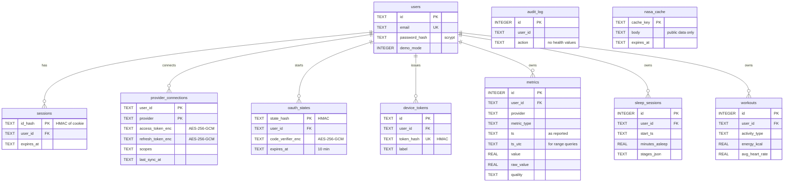

---

## 🔐 Security and privacy

Consumer health data is sensitive, so the defences are layered:

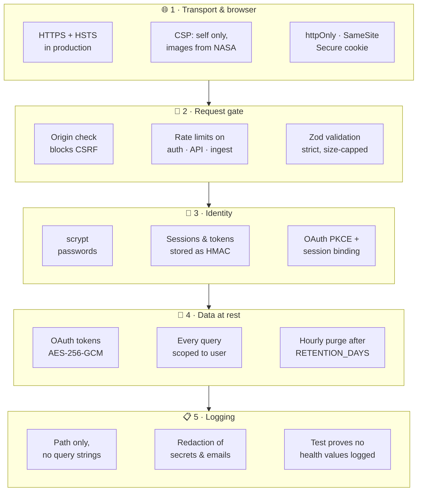

**Users stay in control.** From *Settings & privacy* they can export everything as JSON, delete all
health data, disconnect a provider (which revokes the grant and deletes that provider's data),
revoke device tokens, or delete the account entirely.

Every control, the file it lives in, and what production still needs (KMS, Postgres, MFA, platform
reviews, regulatory review) is listed in [`docs/SECURITY_PRIVACY.md`](docs/SECURITY_PRIVACY.md).

---

## 🖥️ The web dashboard

A React single-page app with hash routing ([`apps/web/src/App.tsx`](apps/web/src/App.tsx)):

| Page | What you see |
|---|---|
| **Vitals** | Heart rate, HRV, SpO₂, respiratory rate, temperature, steps, energy, sleep stages and workouts; quality flags on odd readings |
| **Space & environment** | DONKI space-weather timeline, EONET events on a lat/lon map, POWER surface conditions, APOD with credits |
| **Mission Baseline** | Pick a coded crew profile (C001–C004) and a follow-up sample: five cards (sodium, potassium, glucose, creatinine, albumin) with the reading, change from the preflight median, and the lab-range result as separate facts. Amber only for out-of-range readings or data-quality notices, reason written out. Select a card for the full timeline and the calculation; Evidence tab for source, units, missing data and limits; CSV download |
| **Overlay** | Pick a wearable metric and a NASA series: aligned chart, scatter plot, Pearson *r*, caveats |
| **Connections** | Connect or disconnect providers, import an Apple export, create companion device tokens |
| **Settings & privacy** | Demo mode toggle, export, delete data, delete account |

Visual rules: **solid lines are real data, dashed lines are simulated**, a `DEMO MODE` banner shows
whenever simulated data is on screen, and a medical disclaimer sits on every page.

---

## 🚀 Getting started

### Requirements

- **Node.js ≥ 22.13** (tested on 24.20) and npm ≥ 10
- That's all: no Python, no native builds (SQLite is built into Node)

### Run it locally

```bash
git clone https://github.com/kolavihaan4/nasa-health-project.git
cd nasa-health-project
npm install
npm run setup      # writes .env with fresh random secrets
npm run dev        # API on :8787 + web app on http://localhost:5173
```

Open <http://localhost:5173> and create an account. Demo mode is on by default, so every chart has
data straight away.

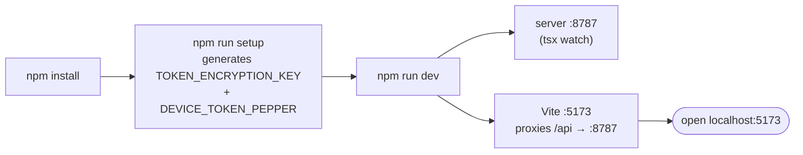

### Bring in your Apple Watch data

1. iPhone → **Health** → profile picture → **Export All Health Data**
2. Unzip it and find `export.xml`
3. In AstroVitals: **Connections → Apple Health export** → choose the file → **Import**
4. Turn demo mode off in **Settings** to see only your real data

### Production-style run

```bash
npm run build      # builds the React app into apps/web/dist
NODE_ENV=production APP_ORIGIN=https://your.domain TRUST_PROXY=1 npm start
```

This serves the API and the app from one origin. It must sit behind HTTPS: the server refuses to
start in production with a non-`https://` `APP_ORIGIN`, because session cookies are `Secure`.

### Scripts

| Command | What it does |
|---|---|
| `npm run dev` | server (watch mode) + Vite dev server with `/api` proxy |
| `npm test` | all 78 tests across shared, server and web |
| `npm run typecheck` | `tsc` for every workspace |
| `npm run build` | production build of the web app |
| `npm start` | server only (serves `apps/web/dist` if built) |
| `npm run setup` | create `.env` with random secrets |
| `npm run gen:key` | print a new 32-byte base64 key |

---

## ⚙️ Configuration

All settings come from environment variables and are validated with Zod at startup
([`config.ts`](apps/server/src/config.ts)). A bad value stops the server with a clear message.
Every option is documented in [`.env.example`](.env.example).

| Variable | Default | Purpose |
|---|---|---|
| `TOKEN_ENCRYPTION_KEY` | — **required** | 32-byte base64 key for AES-256-GCM token encryption |
| `DEVICE_TOKEN_PEPPER` | — **required** | 32-byte base64 key for HMAC of sessions, states, device tokens |
| `PORT` | `8787` | API port |
| `APP_ORIGIN` | `http://localhost:5173` | the only origin allowed to make state-changing requests |
| `DATABASE_PATH` | `./data/astrovitals.sqlite` | SQLite file (git-ignored) |
| `RETENTION_DAYS` | `90` | health data older than this is purged hourly |
| `SESSION_TTL_HOURS` | `12` | session lifetime |
| `TRUST_PROXY` | `0` | set `1` behind a reverse proxy |
| `NASA_API_KEY` | `DEMO_KEY` | only the legacy APOD fallback uses it ([get one free](https://api.nasa.gov/)) |
| `DEFAULT_LATITUDE` / `LONGITUDE` | `29.5502` / `-95.097` | default POWER location (NASA Johnson Space Center) |
| `GOOGLE_HEALTH_CLIENT_ID` / `SECRET` | unset | enables Fitbit / Pixel Watch if your Google project has access |
| `GOOGLE_HEALTH_REDIRECT_URI` | `http://localhost:8787/api/providers/google-health/callback` | must match the OAuth client exactly |
| `LOG_LEVEL` | `info` | pino log level |

---

## 📡 REST API at a glance

Full reference: [`docs/API.md`](docs/API.md).

| Group | Endpoints |
|---|---|
| **Auth** | `POST /api/auth/register` · `POST /api/auth/login` · `POST /api/auth/logout` |
| **Account** | `GET /api/me` · `PATCH /api/me/settings` · `GET /api/me/export` · `DELETE /api/me/data` · `DELETE /api/me` |
| **Vitals** | `GET /api/vitals?from&to` (max 90 days) |
| **Providers** | `GET /api/providers` · `POST /:id/connect` · `GET /:id/callback` · `POST /:id/sync` · `DELETE /:id` |
| **Apple import** | `POST /api/providers/apple-health-export/import?days=N` |
| **Companion** | `GET/POST /api/providers/healthkit-companion/tokens` · `DELETE …/tokens/:id` · `POST /api/ingest/healthkit` |
| **NASA / NOAA** | `GET /api/nasa/space-weather` · `/earth-events` · `/apod` · `/environment` · `/radiation` |
| **Health** | `GET /api/health` |

Every NASA response uses the same envelope:

```json
{ "data": [], "source": "NASA DONKI (CCMC)", "fetchedAt": "2026-10-05T18:00:00.000Z", "stale": false }
```

---

## 🧪 Testing

```bash
npm test            # 78 tests, one Vitest run across all workspaces
npm run typecheck
```

| Suite | Tests | Covers |
|---|---|---|
| `apps/server/test/api.test.ts` | 19 | auth, CSRF/Origin checks, retention, export and deletion, companion ingest, **log hygiene** |
| `apps/server/test/wearables.test.ts` | 19 | full Google OAuth flow against a mocked Google (session binding, encrypted tokens, sync, revoke), Apple export parsing, unit conversion, sleep de-duplication |
| `apps/server/test/nasa.test.ts` | 16 | every NASA parser against **real captured responses**, cache, stale fallback |
| `apps/server/test/crypto.test.ts` | 9 | AES-GCM tamper and AAD checks, scrypt, PKCE (RFC 7636 test vector) |
| `packages/shared/src/shared.test.ts` | 8 | quality flags, correlation maths and caveats |
| `apps/web/src/components/components.test.tsx` | 7 | badges, flags, simulated-data labelling |

The log-hygiene test drives real requests and asserts that **no email, password, OAuth code, token
or health value** ever reaches the log stream. Wearable fixtures are synthetic and labelled as such
([`fixtures/README.md`](apps/server/test/fixtures/README.md)).

---

## 📁 Project structure

```
nasa-health-project/
├── package.json                 workspaces + root scripts
├── .env.example                 every setting, documented
├── packages/shared/src/         contract shared by server & web
│   ├── models.ts                Metric, SleepData, ActivityData, Workout, NASAEvent, …
│   ├── catalog.ts               canonical units + data-quality bounds per metric
│   ├── quality.ts               plausibility flags (never diagnoses)
│   ├── correlation.ts           exploratory Pearson r with caveats
│   └── api.ts                   REST DTOs
├── apps/server/
│   ├── src/
│   │   ├── index.ts · app.ts    bootstrap, middleware stack, error handling
│   │   ├── config.ts            Zod-validated environment
│   │   ├── db.ts · repo.ts      schema/migrations · all SQL
│   │   ├── auth.ts              sessions, Origin check, device tokens
│   │   ├── retention.ts         hourly purge of old data
│   │   ├── lib/                 crypto · safe fetch · logger · errors
│   │   ├── nasa/                donki · eonet · apod · power parsers + service
│   │   ├── wearables/           provider interface, registry, normalization
│   │   │   └── providers/       demo · googleHealth · appleHealthExport · healthkitCompanion · garmin
│   │   └── routes/              auth · me · providers · vitals · nasa · ingest
│   └── test/                    unit + integration tests, real NASA fixtures
├── apps/web/src/
│   ├── App.tsx · main.tsx       shell, hash routing, demo banner
│   ├── lib/                     API client, chart data shaping
│   ├── components/              charts, badges, flags, cards
│   └── pages/                   Dashboard · Space · Correlation · Connections · Privacy · Auth
├── companion/ios/               HealthKit companion app (Swift reference) + setup guide
├── scripts/setup.mjs            generates .env with random secrets
└── docs/                        architecture · API · NASA · wearables · security · research
```

---

## 🛣️ Known limits and roadmap

| Area | Today | Next step |
|---|---|---|
| Fitbit / Pixel | code complete, blocked on Google Health API onboarding | enable when access opens |
| Garmin | adapter slot only | apply for the Garmin Health API partner programme |
| Wear OS / Health Connect | not started | Android companion app (Health Connect has no cloud API) |
| iOS companion | Swift reference code, not compiled | build and sign in Xcode on a Mac |
| Database | SQLite | managed Postgres with encryption at rest |
| Keys | environment variables | KMS + rotation (the `v1.` ciphertext prefix exists for this) |
| Accounts | email + password | email verification, password reset, MFA, lockout |

Do not put real users' data on a public deployment until the production items in
[`docs/SECURITY_PRIVACY.md`](docs/SECURITY_PRIVACY.md) are done.

---

## 📚 Documentation

| Doc | What's in it |
|---|---|
| [Architecture](docs/ARCHITECTURE.md) | stack, schema, provider abstraction, request flows |
| [REST API](docs/API.md) | every endpoint, body, limit and error code |
| [NASA APIs](docs/NASA_APIS.md) | endpoints, auth, limits, fields, caveats |
| [Wearables](docs/WEARABLES.md) | what each platform offers, access paths, OAuth scopes, what needs approval |
| [Security & privacy](docs/SECURITY_PRIVACY.md) | every control, where it lives, what production needs |
| [iOS companion](companion/ios/README.md) | HealthKit setup, entitlements, background delivery |
| [Research notes](docs/research/README.md) | raw findings and captured API samples |

---

## 📄 License and attribution

**Apache-2.0** (Space Apps requires an OSI-approved license). See [`LICENSE`](LICENSE).

NASA data comes from DONKI (CCMC), EONET, APOD and POWER (LaRC). Attribution notes are in
[`docs/NASA_APIS.md`](docs/NASA_APIS.md). APOD images carry their own credits and copyrights, which
the UI always shows next to the image.

<div align="center">
<sub>Built for NASA Space Apps Challenge 2026 · not affiliated with or endorsed by NASA</sub>
</div>

## Dashboard UI template

The standalone, frontend-only dashboard design is available in [templates/dashboard](templates/dashboard). It includes the responsive top navigation, misty mountain scenery, reusable blank cards, and browser-local interactions. Open its `index.html` directly, or run `npm start` from that folder for a local static preview. See the [template README](templates/dashboard/README.md) for setup and a screenshot.

## Guardian front end (v2)

The Guardian home site from the `v2` branch is a static site in [`apps/web/public/home`](apps/web/public/home): `index.html`, `css/`, `js/`, `assets/` and `tools/`. The web app serves it at `/home/index.html` and links to it from its navigation. It needs no install and no build step. Its own notes follow; the paths in them are relative to that folder.

A calm workspace for a NASA Space Apps team: capture cards (ideas, observations, questions, datasets, tasks), group them into collections, and watch the dashboard fill in.

### Run it

Open `index.html` in Chrome, Edge or Firefox. No install and no build step. Cards are saved in the browser (localStorage); use **Settings → Export** to keep a copy.

### The opening

- While the app loads, a planet sits in the centre of a deep-blue screen with a ship orbiting it (it passes behind the planet and leaves a trail).
- The ship circles for at least 5 seconds (`ORBIT_MS` in `js/loader.js`).
- When the app is ready, the ship finishes its lap and lands, the blue opens from the centre into the misty dashboard, and the same planet-and-ship element shrinks and flies into the header, where it becomes the logo (about 1.7 s).
- The logo goes to the Dashboard from any page. On the Dashboard it scrolls to the top; it never replays the opening. Hovering it makes the ship slip along its orbit.
- With **reduced motion** turned on (in Windows: Settings → Accessibility → Visual effects → Animation effects **off**), the ship still circles for its 5 seconds, but instead of flying into the header the opening ends in a short cross-fade.
- **Settings → Opening animation** turns the opening off; **Replay opening** plays it again.

### Choosing an environment

- Straight after the opening, a first visit shows **Where is your crew?**: the International Space Station, Mars, the Moon and a Spacecraft in transit, each a card with a photo above its name, a short description and a few facts. The whole card is the button; the chosen card gets a teal ring and a check.
- Nothing else (dashboard, nav, search) is reachable until one is chosen. **Continue to dashboard** saves it in the browser.
- On the next visit the saved environment loads straight away and the picker is skipped.
- Change it any time from the environment pill in the header, the name in the welcome panel, or **Settings → Mission environment**. New cards are stamped with the environment they were made in.

Photos (public domain, via Wikimedia Commons): ISS after STS-132 undocking (NASA), *Getting to Know Mount Sharp*, PIA16099 (NASA/JPL-Caltech/MSSS), Buzz Aldrin on Apollo 11 (NASA), Orion with the Moon and Earth on Artemis I, art001e000673 (NASA). Stored in `assets/env/`.

### Files

| File | What it does |
|---|---|
| `js/mark.js` | The planet-and-ship mark: orbit maths, front/back layering, trail, landing curve, hover nudge |
| `js/loader.js` | The opening: hold until ready, radial reveal, flying the mark into the header, reduced-motion path |
| `js/scenery.js` | The misty mountains and pines, drawn as one SVG at start-up |
| `js/app.js` | Routes, dashboard, My cards, Collections, Card library, Settings, modals, search (Ctrl K) |
| `js/store.js` | Saved state |
| `css/app.css` | Everything visual |

### Test it

```
node tools/check.mjs
```

Starts a headless Chrome or Edge and runs 75 checks, including the environment picker (order, photos loaded and above each name, one radius, even spacing, gate, selection, saving, restoring on reopen, changing, cancel, phone and tablet layouts) and: the loader covers the screen with the mark in the exact centre; the ship orbits while loading; clicks do nothing until the app is ready; the reveal takes 1.5–2 s; the mark lands exactly in the header slot as the same element; logo navigation; the add-card flow; every route; search; desktop, wide, tablet, phone and 320 px widths with no sideways scroll; reduced motion; the opening switched off; and no script errors. Screenshots of each stage go to `tools/shots/`.
