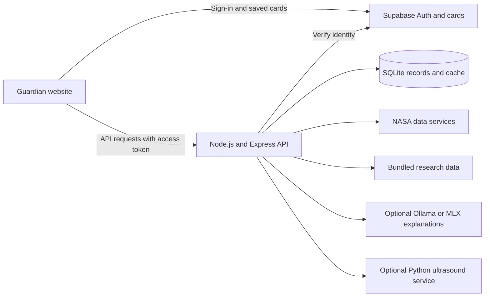

<div align="center">


# Guardian

**Record your vitals. Understand your trends. Explore the challenges of spaceflight.**

A NASA Space Apps Challenge 2026 prototype that brings account-saved health cards, simple graphs, space-hazard information and an educational triage assistant into one website.

[Features](#features) · [Run locally](#run-locally) · [Configuration](#configuration) · [Data sources](#data-sources) · [Documentation](#documentation)

</div>

> **Educational prototype, not a medical device.** Guardian is not validated for clinical or flight use. Its readings, rules and model outputs must not be used to diagnose conditions or make medical decisions. NASA environment data does not measure anyone’s health.

## Features

| Page or feature | What it does |
| --- | --- |
| **Dashboard** | Shortcuts to log vitals, open saved cards, review a concern and explore hazards. |
| **Cards** | Saves named cards to the signed-in account, with optional blood pressure, heart rate, temperature, sleep, mood, breathing rate and blood oxygen entries. Units are included; circled **i** buttons explain the equipment and recording steps. |
| **User vitals** | Graphs the readings in saved cards. A dropdown selects the vital, points show recorded entries, and a table lists exact values and dates. Blood pressure shows both numbers; mood stays as words. |
| **Triage** | An interactive body explorer, plain-language reading explanations, an educational rules-based review, optional AI explanations and ultrasound tools. A daily healthy-habits checklist tracks activity points for the current visit. |
| **Hazards** | Five simple summaries of NASA’s spaceflight hazards, with NASA space-weather, Earth-event and surface-environment data. Graphs explain their units and sources. |
| **NASA study readings** | Explores bundled Inspiration4 lab results before and after flight. These are research participants’ results, separate from the signed-in user’s cards. |
| **Compare with NASA data** | Compares available provider or clearly labelled demo measurements with NASA data on matching dates. A shared pattern does not establish a cause. |
| **Sources & citations** | Searchable references for research, graphs, equipment, software and visual assets. References supplied without exact publication links are identified as named references. |
| **Guided tour** | A step-by-step walkthrough for new accounts. Replay it using the **?** button in the top bar. |
| **Settings and account** | Mission environment, appearance and animation preferences, data export, deletion and sign-out controls. |

The interface includes responsive layouts, gentle hover effects and reduced-motion support. Pages load on demand, and the loading indicator stays simple.

## First visit

1. Create an account or sign in.
2. Choose the space station, Moon, Mars or a spacecraft as your mission environment.
3. Select **Log vitals**, name the card and enter the readings you have. Leave unavailable readings blank.
4. Use a circled **i** for equipment help, then select **Done** to save the card to your account.
5. Open **Vitals → Over time** and choose a vital from the dropdown. Save more cards to see changes over time.
6. Open **Cards** to view or edit an entry. Use **?** whenever you want the guided tour again.

An empty graph means no saved cards contain that reading yet. Guardian does not fill missing card readings with invented values or demo data. Lines connect recorded entries; they do not represent measurements taken between those entries.

## Run locally

### Requirements

- **Node.js 24** is the version used by the production Docker image. The package manifest requires Node.js **22.13 or later**.
- **npm** and **Git**.
- An internet connection for Supabase sign-in and account cards, and for fresh NASA data.
- Python and a language-model service are optional; see [Optional models](#optional-models).

### Start the website

Run these commands from a terminal:

```bash
git clone https://github.com/kolavihaan4/Guardian-app-spaceapps-2026.git
cd Guardian-app-spaceapps-2026
npm ci
npm run setup
npm run dev
```

`npm run setup` creates a private `.env` file from `.env.example` and generates the two server secrets. It leaves an existing `.env` untouched. When upgrading an existing checkout, compare it with the current template and add any missing settings.

After the servers report that they are ready, open **http://localhost:5173**. Keep the terminal running while using the site.

| Service | Default local address | Required? |
| --- | --- | --- |
| Website | `http://localhost:5173` | Yes |
| Guardian API | `http://localhost:8787` | Yes |
| API health check | `http://localhost:8787/api/health` | Returns `{ "ok": true }` when the API is running |
| Ultrasound service | `http://127.0.0.1:8790` | Optional |
| Ollama | `http://localhost:11434` | Optional |
| MLX model server | `http://localhost:8080` | Optional alternative |

`npm run dev` starts the web app, API and ultrasound launcher. If the Python dependencies are unavailable, the launcher reports that scan analysis is off and keeps the rest of the website running. It does **not** start Ollama or install model weights.

The home dashboard is served at `/home/index.html#/dashboard`; User vitals is at `/#/dashboard`. Both share the same navigation and sign-in session. Run the full application through its server rather than opening the HTML file directly.

### If the website will not load

- Check that `npm run dev` is still running and use the address printed by Vite.
- Check `/api/health` on the API port. A working page still needs the API for protected application features.
- If a port is already in use, resolve that conflict before restarting. Custom ports must agree across `.env`, `APP_ORIGIN` and the proxy in `apps/web/vite.config.ts`.
- If sign-in or saving fails, check the connection to the configured Supabase project and its account/card permissions.
- A missing AI or ultrasound service does not prevent basic cards and User vitals from working.

## Configuration

Use [`.env.example`](.env.example) as the full configuration reference. Keep `.env` private and out of Git.

| Setting | Purpose |
| --- | --- |
| `PORT` | API port; defaults to `8787`. |
| `APP_ORIGIN` | Website origin allowed to make browser requests; defaults to `http://localhost:5173`. |
| `DATABASE_PATH` | Local SQLite file for server-side records, imported measurements and caches. |
| `TOKEN_ENCRYPTION_KEY` | Protects stored provider tokens. Generated by `npm run setup`. |
| `DEVICE_TOKEN_PEPPER` | Protects companion-device token hashes. Generated by `npm run setup`. |
| `SUPABASE_URL` / `SUPABASE_PUBLISHABLE_KEY` | Supabase project used for sign-in verification. Use a publishable key, never a service-role or secret key in browser code. |
| `RETENTION_DAYS` | Retention window for server-stored wearable measurements; defaults to `90`. It does not automatically expire account cards. |
| `NASA_API_KEY` | Used by the legacy APOD fallback. The configured DONKI, EONET, POWER and newer APOD integrations use their own endpoints. |
| `TRIAGE_BACKEND` | Set explicitly to `ollama` for Ollama or `mlx` for the MLX backend. |
| `OLLAMA_URL` / `OLLAMA_TRIAGE_MODEL` | Ollama address and installed model name. The current model-name default is `astrovitals-triage-ft-v2`. |
| `MLX_URL` | Address of the optional MLX model server. |
| `TRIAGE_MODEL_TIMEOUT_MS` | Time allowed for a model explanation before the rules-only response; defaults to `20000`. |
| `ULTRASOUND_PYTHON` / `ULTRASOUND_URL` | Python executable override and address of the scan-analysis service. |
| `GOOGLE_HEALTH_*` / `GARMIN_*` | Optional provider credentials; access and implementation requirements vary by provider. |

### Supabase accounts and cards

The browser’s shared client is configured in [`apps/web/public/home/js/auth.js`](apps/web/public/home/js/auth.js). Its project must match the server’s Supabase settings. Changing `.env` alone does not reconfigure that browser client.

The current application expects:

- Supabase Auth for email/password sign-in.
- A `public.cards` table with `user_id`, `id` and JSON `body` fields, a unique `(user_id, id)` key, and row-level policies restricting reads and writes to the signed-in owner.
- A restricted `delete_my_account` RPC for the account-deletion control, with deletion of that account’s cards.

`npm run setup` creates local configuration; it does not provision these external database resources. If using a different Supabase project, configure and review those resources before connecting the app.

## Data sources

Guardian keeps three kinds of information distinct:

| Information | Source and meaning |
| --- | --- |
| **Your recorded vitals** | Values entered into cards saved to your account. They are user-provided observations, not live NASA crew telemetry or automatically verified sensor readings. |
| **Research results** | Bundled public study data, including NASA OSD-575 Inspiration4 lab results and astronaut blood-pressure reference data. Study participants are not the current user. |
| **Space and Earth conditions** | Public NASA APIs. These describe environmental context, not a person’s exposure or a diagnosis. |

### NASA integrations

| Source | Used for |
| --- | --- |
| [NASA Human Research Program](https://www.nasa.gov/hrp/hazards/) | Space radiation, isolation and confinement, distance from Earth, gravity fields, and hostile or closed environments. |
| [DONKI](https://ccmc.gsfc.nasa.gov/tools/DONKI/) | Solar flares, solar clouds/CMEs, magnetic storms and fast-particle event reports. Counts of reports are not radiation-dose measurements. |
| [EONET](https://eonet.gsfc.nasa.gov/docs/v3) | Natural events on Earth, with approximate event locations. |
| [POWER](https://power.larc.nasa.gov/docs/services/api/temporal/daily/) | Daily surface temperature, humidity, pressure, wind, sunlight and UV estimates for selected Earth locations. These are not spacecraft cabin readings. |
| [APOD](https://apod.nasa.gov/apod/astropix.html) | Astronomy imagery and educational context; individual image credits and reuse rules apply. |
| [NASA OSD-575](https://osdr.nasa.gov/bio/repo/data/studies/OSD-575) | Recorded Inspiration4 lab data used by the NASA study view. |

The Hazards page uses a rolling **14-day** window that advances at midnight **UTC**, and catches up when a background tab becomes active again. Source publication delays, request failures and caching affect freshness. The interface shows available readings and update information; it does not promise a new NASA measurement every day. The Hazards graphs use NASA sources; a separate NOAA integration also exists elsewhere in the project.

The in-app **Sources & citations** page includes the supplied clinical and equipment references, software credits and research links. A reference or discovery portal is not automatically a usable training dataset; access and reuse conditions still apply.

### Wearable integrations

The backend also includes Apple Health XML import, token-based HealthKit companion ingestion, a Google Health OAuth adapter and a Garmin adapter entry. These are separate from the saved-card graph. Some require external credentials, platform access or additional implementation; their presence does not mean a watch is connected automatically.

See [Wearable integrations](docs/WEARABLES.md) and the [iOS companion reference](companion/ios/README.md) for the supported workflows and limits.

Demo provider measurements are generated on request, labelled as simulated and kept separate from recorded data. They are not persisted as real measurements or substituted into User vitals cards.

## How the application fits together



The frontend combines a static home workspace with React application pages. Vite serves both during development and forwards `/api` requests to the backend. The Node server serves the built site in a production-style run.

Sign-in and cards communicate directly with Supabase. Protected Guardian API calls send a Supabase bearer token, which the server verifies. Wearable imports and server-side records use SQLite; account cards use Supabase. Display preferences and some visit state remain in the browser.

Passwords are handled by Supabase Auth. Provider tokens are encrypted at rest, companion tokens are hashed, and application logs are designed to exclude health values and credentials. These controls do not establish clinical suitability or production compliance. Review [Security and privacy](docs/SECURITY_PRIVACY.md) before handling real users’ health information.

## Optional models

### Triage explanations

The deterministic rule engine decides the displayed status and escalation. The language model supplies an explanation; it does not replace those decisions. If the model is unreachable, times out or returns an invalid response, the server uses its rules-only response.

For an installed Ollama fine-tuned model, set these values explicitly in `.env` and run Ollama separately:

```dotenv
TRIAGE_BACKEND=ollama
OLLAMA_URL=http://localhost:11434
OLLAMA_TRIAGE_MODEL=astrovitals-triage-ft-v2
```

Setting the name does not download or create that model. Fine-tuned artifacts must be prepared and imported separately. See the [AI guide](ai/README.md), [PC training guide](ai/training/README-PC.md) and [model-service deployment configuration](ai/model_server/docker-compose.yml).

The repository also includes an alternate MLX workflow for Apple silicon. `npm run model` requires its Python environment, base model and adapter files; it is not a general Windows startup command.

Reported training scores compare model outputs with project-generated rules and scenarios. They are not clinical accuracy measurements or evidence of astronaut validation.

### Ultrasound analysis

The scan tools use a separate Python service for neck-vein and heart-image research models. Install its dependencies in a repository-root virtual environment:

```bash
python -m venv .venv
```

On Windows:

```powershell
.venv\Scripts\python -m pip install -r ai/ultrasound_service/requirements.txt
```

On macOS or Linux:

```bash
.venv/bin/python -m pip install -r ai/ultrasound_service/requirements.txt
```

Restart `npm run dev` after setup. The launcher searches for `ULTRASOUND_PYTHON`, the root `.venv`, then Python on `PATH`. Model files must also be present. Without the service, the interface reports that scan analysis is unavailable.

Uploaded frames are resized in the browser, passed through the API and processed in memory by the scan service. Predicted outlines and derived measurements are labelled as model outputs. The models use SegThy and CAMUS research data and are not validated for clinical or astronaut use. See the [ultrasound service guide](ai/ultrasound_service/README.md) for inputs, model files and dataset licences.

## Development and checks

| Command | Purpose |
| --- | --- |
| `npm ci` | Install the dependencies recorded in the lockfile. |
| `npm run setup` | Create `.env` with fresh server secrets if it does not already exist. |
| `npm run dev` | Start the web app, API and optional ultrasound launcher. |
| `npm run typecheck` | Check all npm workspaces. |
| `npm test` | Run the Vitest suites across the project. |
| `npm run test:watch` | Run tests while developing. |
| `npm run build` | Build the website into `apps/web/dist`. |
| `npm start` | Start the Node API, which also serves an existing website build. |
| `npm run ultrasound` | Run the optional scan-service launcher separately. |
| `npm run gen:key` | Generate a server-secret value; keep it private. |

Tests cover shared calculations, API behavior, authentication, provider handling, NASA fixtures, page components, saved-card parsing and the guided tour. Mocked external services test application behavior without establishing that a real external integration is configured or medically validated. Use the output from your own run rather than a fixed test-count badge.

The home workspace has an additional browser-check script:

```bash
cd apps/web/public/home
node tools/check.mjs
```

Its browser dependencies and checks are documented in the [home workspace README](apps/web/public/home/README.md).

## Build and deployment

```bash
npm run build
npm start
```

Set configuration for the address serving the build before starting it. For a local built-site preview, use an `APP_ORIGIN` matching the Node server’s origin. For a public deployment, use HTTPS, the actual public `APP_ORIGIN`, and the appropriate proxy settings. Preserve the database and encryption keys across restarts.

The repository includes a [Dockerfile](Dockerfile), [Docker Compose configuration](docker-compose.yml) and [Google Cloud deployment guide](docs/DEPLOY_GOOGLE_CLOUD.md). The language model may run as a separate service. Check deployment configuration, external account resources and model availability in the target environment; committing or pushing this repository does not itself publish a hosted website.

## Project structure

```text
apps/
  web/
    public/home/        Home workspace, cards, shared sign-in, navigation and tour
    src/pages/          User vitals, triage, hazards, study views and citations
    src/components/     Charts, body explorer and ultrasound tools
  server/
    src/                API, account verification, providers, NASA cache and model routes
    test/               API tests and external-service fixtures
packages/shared/        Shared types, calculations, reference data and triage rules
ai/                     Model configuration, training and ultrasound services
companion/ios/          HealthKit companion reference implementation
information(DATASETS)/  Bundled research data
docs/                   API, architecture, source notes and deployment guides
scripts/                Setup, development and deployment helpers
templates/dashboard/    Standalone design template; separate from the full application
```

## Current limits

- User vitals graphs reflect what was entered into cards, not continuous monitoring or independently verified measurements.
- Account sign-in and card storage need the configured Supabase service. Guardian is not a fully offline account system.
- NASA data can arrive late or be unavailable. Cached environmental data is not a live spacecraft safety feed.
- Triage rules, AI explanations and ultrasound estimates are research features, not approved medical procedures.
- Daily habit points track the current visit and do not measure health or mission readiness.
- Provider access, model artifacts and production deployment require setup beyond cloning the repository.

## Documentation

| Resource | Contents |
| --- | --- |
| [Project document](https://docs.google.com/document/d/1Ayt9jG7U3B0Ac0vH1J1XPdUAVpobfBrFPonQnDJ3gls/edit?usp=sharing) | Team’s shared project document. |
| [Architecture](docs/ARCHITECTURE.md) | System components and design background. |
| [API reference](docs/API.md) | Routes, request formats and responses. |
| [NASA sources](docs/NASA_APIS.md) | Data endpoints and source notes. |
| [Wearables](docs/WEARABLES.md) | Platform adapters and connection requirements. |
| [Security and privacy](docs/SECURITY_PRIVACY.md) | Implemented controls and remaining production work. |
| [AI and training](ai/README.md) | Model workflows, evaluation context and fallback behavior. |
| [PC training](ai/training/README-PC.md) | NVIDIA/Windows training and model-export workflow. |
| [Ultrasound service](ai/ultrasound_service/README.md) | Scan-analysis setup and dataset credits. |
| [Deployment](docs/DEPLOY_GOOGLE_CLOUD.md) | Container and hosting instructions. |
| [AI-use disclosure](docs/SI_DISCLOSURE.md) | Development assistance and runtime AI use. |
| [Provenance metadata](apps/web/public/si-provenance.json) | Code, data and media provenance records. |

## License and credits

Guardian’s application code is licensed under [Apache-2.0](LICENSE). Third-party datasets, model assets, anatomy models, images and libraries retain their own licences and attribution requirements; the code licence does not replace them.

NASA environment imagery includes credits to NASA, the STS-132 crew, NASA/JPL-Caltech/MSSS and Neil Armstrong. Individual APOD images may carry separate copyrights. Anatomy, SegThy and CAMUS credits are listed on the website’s Citations page and in the relevant source guides.

Codex and Claude assisted development and documentation. Runtime AI features include Qwen3-8B explanations and ultrasound model predictions. Synthetic examples and model outputs remain distinct from source measurements. See the disclosure and provenance records above, including any credits still awaiting team confirmation.

Built for the [NASA Space Apps Challenge 2026](https://www.spaceappschallenge.org/2026/challenges/create-health-monitoring-software-for-astronauts-on-space-missions/). Guardian is not affiliated with or endorsed by NASA.
