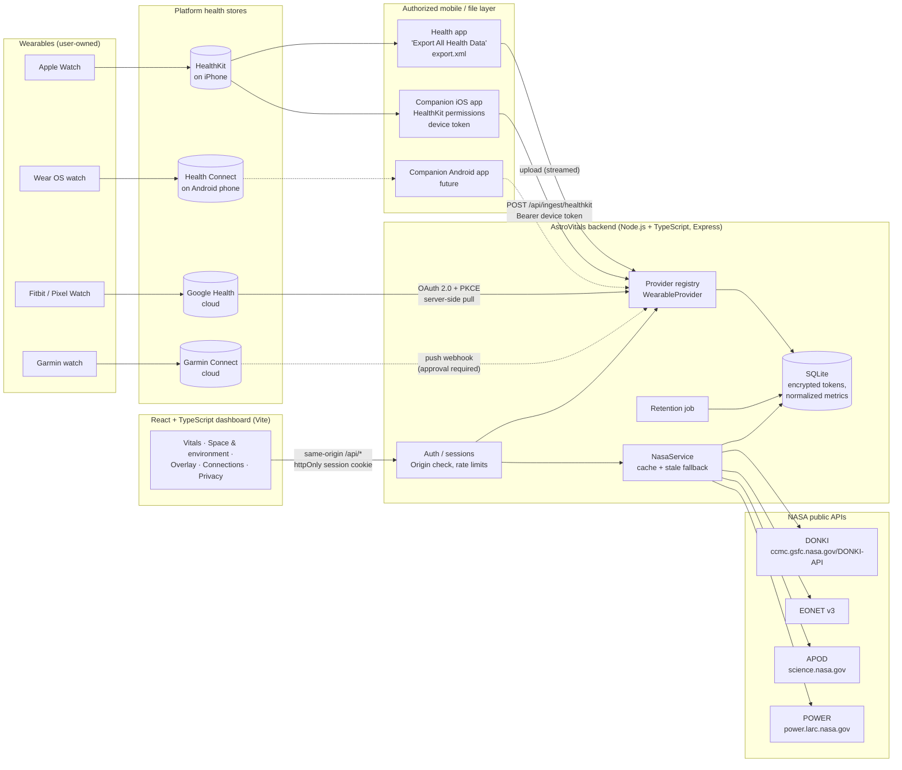

# Architecture

## System diagram



ASCII version (for terminals):

```
Apple Watch ─► HealthKit (iPhone) ─┬─► Health app export.xml ──upload──┐
                                   └─► companion iOS app ──POST+token──┤
Fitbit/Pixel ─► Google Health cloud ──OAuth2+PKCE (server pull)────────┤
Garmin ─► Garmin Connect ──(push webhook, approval required)───────────┤
Wear OS ─► Health Connect (phone) ─► companion Android app (future) ───┤
                                                                       ▼
NASA DONKI / EONET / APOD / POWER ◄── NasaService ◄── Express API ──► SQLite (encrypted tokens,
                                          (cache)        ▲             normalized metrics, retention)
                                                         │ same-origin /api, httpOnly cookie
                                               React dashboard (browser)
```

The browser never talks to NASA or to a wearable platform directly. It holds no API keys and no
OAuth tokens; it only has an httpOnly session cookie for our own origin.

## Technology stack (and why)

| Layer | Choice | Why |
|---|---|---|
| Frontend | React 19 + TypeScript, Vite 8 | Required by the brief; fast dev server with `/api` proxy so cookies stay first-party |
| Charts | Recharts 3 | Declarative React charts; time axes, tooltips, small multiples |
| Backend | Node.js 24 + TypeScript (run with `tsx`), Express 5 | Required; Express 5 forwards async errors natively |
| Validation | Zod 4 | One schema per input: env, query, body, ingest payload |
| Database | SQLite through Node's built-in `node:sqlite` | Zero native build steps on Windows/macOS/Linux; easy to swap for Postgres (SQL is plain and parameterized) |
| Security | helmet (CSP, HSTS in prod), express-rate-limit, AES-256-GCM via `node:crypto`, scrypt passwords | No third-party crypto |
| Logging | pino with redaction + path-only request logs | Structured logs that cannot carry health values |
| Tests | Vitest 5, Supertest, Testing Library | One runner for all three packages |
| Monorepo | npm workspaces: `packages/shared`, `apps/server`, `apps/web` | Shared types are the API contract |

## Directory structure

```
Health Project/
├── package.json                 workspaces + root scripts (dev, test, build, gen:key)
├── .env.example                 every setting, documented
├── packages/shared/src/         contract shared by server & web
│   ├── models.ts                Metric, SleepData, ActivityData, Workout, NASAEvent, …
│   ├── catalog.ts               metric units + data-quality bounds, provider descriptions
│   ├── quality.ts               plausibility flags (never diagnoses)
│   ├── correlation.ts           exploratory Pearson r with caveats
│   └── api.ts                   REST DTOs
├── apps/server/
│   ├── src/
│   │   ├── index.ts, app.ts     bootstrap, middleware, routes, error handling
│   │   ├── config.ts            zod-validated env
│   │   ├── db.ts, repo.ts       schema/migrations, all SQL
│   │   ├── auth.ts              sessions, Origin check, device tokens, validation helper
│   │   ├── retention.ts         hourly deletion of old data
│   │   ├── lib/                 crypto (AES-GCM, scrypt, PKCE), http (safe fetch), logger, errors
│   │   ├── nasa/                donki.ts, eonet.ts, apod.ts, power.ts (pure parsers) + service.ts
│   │   ├── wearables/           types.ts (WearableProvider), registry.ts, normalize.ts, stored.ts
│   │   │   └── providers/       demo, googleHealth, appleHealthExport, healthkitCompanion, garmin
│   │   └── routes/              auth, me, providers, vitals, nasa, ingest
│   └── test/                    unit + integration tests, fixtures (real NASA responses)
├── apps/web/src/
│   ├── App.tsx, main.tsx        shell, hash routing, demo banner
│   ├── lib/api.ts, series.ts    API client, chart data shaping
│   ├── components/              charts.tsx, common.tsx (badges, flags, cards)
│   └── pages/                   Dashboard, Space, Correlation, Connections, Privacy, Auth
├── companion/ios/               HealthKit companion app reference (Swift) + README
└── docs/                        this file, API.md, NASA_APIS.md, WEARABLES.md, SECURITY_PRIVACY.md, research/
```

## Provider abstraction

```ts
interface WearableProvider {
  readonly id: ProviderId
  availability(): { available: boolean; note: string }
  getHeartRate(userId, start, end): Promise<Metric[]>
  getSleep(userId, start, end): Promise<SleepData[]>
  getActivity(userId, start, end): Promise<ActivityData[]>
  getMetrics(userId, start, end, types?): Promise<Metric[]>   // all vitals, every one optional
  getWorkouts(userId, start, end): Promise<Workout[]>
}
interface OAuthWearableProvider extends WearableProvider {
  readonly scopes: readonly string[]
  getAuthorizationUrl(userId): string
  handleOAuthCallback(code, state, sessionUserId): Promise<void>
  sync(userId, start, end): Promise<SyncResult>
  disconnect(userId): Promise<void>                         // revoke + forget tokens
}
```

Differences from the brief's suggested interface: the OAuth methods take the signed-in user and the
`state` value (needed for CSRF protection, PKCE, session binding and per-user storage), and
`getMetrics`/`getWorkouts` were added because the dashboard needs every vital, not only heart rate.

| Provider | Kind | Read path |
|---|---|---|
| `DemoProvider` | simulated | generated per request, deterministic per user/day, never stored |
| `GoogleHealthProvider` | OAuth (server pull) | `sync()` stores normalized data; reads from DB |
| `AppleHealthExportProvider` | file import | streaming parser stores data; reads from DB |
| `HealthKitCompanionProvider` | device push | `/api/ingest/healthkit` stores data; reads from DB |
| `GarminProvider` | approval required | adapter slot, reports unavailable |

Adding a platform = one class + one line in `wearables/registry.ts` + its id in `PROVIDER_IDS`.

## Data model rules

- **Raw measurements are never altered.** Conversions to canonical units keep the original in
  `raw` (`spo2: 97 %` with `raw: {value: 0.97, unit: '%'}`; `degF → °C`; `kJ → kcal`). Original
  timestamps with their UTC offset are stored as reported (`ts`), plus a UTC copy for range queries.
- **Source on every record** (`source` = provider, `sourceDetail` = upstream app/platform,
  `device`), and `simulated` on every record.
- **Simulated data is never persisted.** `Repo.saveHealthData` throws on `simulated: true`.
- **Display downsampling** (long heart-rate ranges) averages per source into labelled buckets in the
  API response only; stored data and `GET /api/me/export` remain raw. Implausible readings are never
  averaged away.

## Database schema (SQLite; see `apps/server/src/db.ts`)

| Table | Purpose | Sensitive columns |
|---|---|---|
| `users` | account, demo-mode flag | `password_hash` (scrypt) |
| `sessions` | login sessions | `id_hash` = HMAC of the cookie value |
| `provider_connections` | one row per user × provider | `access_token_enc`, `refresh_token_enc` (AES-256-GCM, AAD = user:provider) |
| `oauth_states` | single-use OAuth state + PKCE verifier (10 min) | `state_hash` (HMAC), `code_verifier_enc` |
| `device_tokens` | companion-app tokens | `token_hash` (HMAC) |
| `metrics` | normalized measurements | health data (retention-limited) |
| `sleep_sessions` | sleep with stages JSON | health data |
| `workouts` | exercise sessions | health data |
| `audit_log` | who did what (connect, import, delete) | no health values |
| `nasa_cache` | public NASA responses | none |

All tables reference `users(id) ON DELETE CASCADE`, so deleting an account removes everything.
Moving to PostgreSQL: the SQL is portable apart from `INSERT … ON CONFLICT` (supported by both) and
types; keep the encryption at the application layer.

## Request flow examples

- **Dashboard load:** `GET /api/vitals?from&to` → for each connected provider (plus Demo if enabled)
  read normalized data → derive daily activity → downsample long HR → JSON with per-source counts.
- **Google connect:** `POST /api/providers/google-health/connect` → state + PKCE verifier stored
  (HMAC / encrypted) → browser goes to Google → `GET …/callback?code&state` → state consumed, must
  match the signed-in user → server-side token exchange with `code_verifier` → tokens encrypted →
  redirect to `#/connections?status=connected`.
- **NASA panel:** `GET /api/nasa/space-weather` → cache hit? → else DONKI ×4 in parallel → parse →
  cache → JSON `{ data, source, fetchedAt, stale }`.
