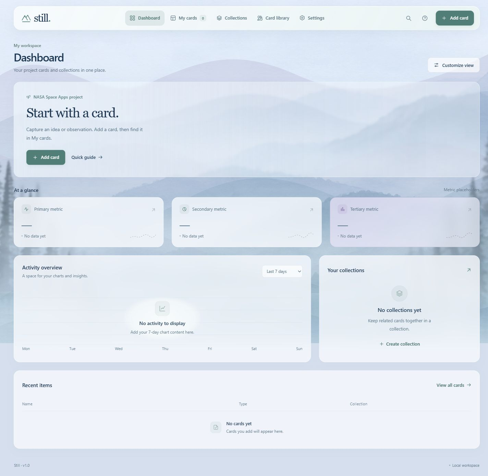

# Mission Baseline — dashboard UI template

A runnable, blank dashboard template for the Mission Baseline project. The Still visual design combines misty blue mountains, natural evergreen silhouettes, sage controls, a small lavender accent, and translucent glass cards.



## Run locally

Open `index.html` directly in a modern browser. All scripts, icons, styling, and artwork are bundled locally.

For the optional static preview, use Node.js 18 or later:

```sh
cd templates/dashboard
npm start
```

Open [localhost:4173](http://localhost:4173). No installation or build step is needed. Press Ctrl+C to stop the preview. If you downloaded only this template folder, run `npm start` from that folder instead.

## Included

- **Dashboard:** welcome area, empty metrics and chart, collections, and recent cards. Customize view shows or hides sections.
- **My cards:** create and edit notes, metric placeholders, and chart placeholders; pin favorites and organize them into collections.
- **Collections:** group related cards. Removing a collection keeps its cards.
- **Card library:** reusable card patterns, working controls, palette, typography, and empty states.
- **Settings:** workspace name, sage/blue/lavender accents, spacing, scenery, JSON export, and reset.

The sticky top bar holds the page links, search, help, and Add card. Tablet layouts use two rows. Phone layouts keep the page links in a scrollable row and reveal the selected page automatically.

Navigation supports browser Back/Forward. Search opens with `/` or Ctrl/Cmd+K and finds card titles, details, collections, and pages. Tabs support arrow keys, Home, and End; dialogs support Escape.

## Local data

This folder is a standalone frontend template. It has no backend, database, APIs, authentication, analytics, external fonts, or remote assets. The optional preview utility serves static files only.

Cards, collections, and preferences are saved in this browser's localStorage under `still-template-v1`. Nothing is sent elsewhere. If storage is blocked, the template still works for the current session and explains that changes are temporary. Direct file access and localhost may have separate workspaces.

Export layout downloads a JSON snapshot. There is no import screen or data connection. Metric values and charts are intentionally blank.

## Project files

| File | Purpose |
| --- | --- |
| `index.html` | Application shell, top navigation, and accessible dialogs |
| `styles.css` | Colors, frosted surfaces, responsive layouts, and reduced-motion support |
| `app.js` | Page rendering, reusable cards, navigation, and local state |
| `assets/` | Bundled mountain artwork, flowing waves, two evergreen compositions, and favicon |
| `preview.mjs` | Optional dependency-free static preview |

Change the shared color tokens in `styles.css` to adjust the palette. Page copy and card patterns live in `app.js`.

## Validation

```sh
npm run check
```

The top-navigation version passed 30 targeted browser checks across all five pages at 1440px, 1024px, 390px, and 320px. Checks covered active-link visibility, sticky positioning, keyboard access, search/help/card creation, workspace renaming, reload persistence, and phone dialogs. No browser warnings or errors were observed.

## Artwork

The mountain landscape is original generated artwork bundled with this template. The evergreen compositions are local SVG illustrations with varied branches, canopies, and heights. The supplied mindfulness mockup informed the palette and atmosphere; it is not embedded in the interface.
